# 联盟视界
英雄联盟国服战绩助手工具 | LoL Data Companion

> 实时查询战绩、卡片展示、选人提醒，让你的峡谷之旅更智能！

本仓库是 [mizi6654/LeagueHistory](https://github.com/mizi6654/LeagueHistory) 的分支（geezhu），在上游基线 `42db0c3` 之上新增 182 个提交，涉及 396 个文件。下面先列出相对上游的主要改动，再介绍完整功能。

## 相对上游的主要改动

| 方向 | 改动 |
|---|---|
| 战绩与玩家主页 | 重做玩家主页：段位徽章、近期胜率总览、近期英雄与职业分布、英雄成就海报墙；历史战绩支持胜负 / 模式筛选和分页；最近搜索记录 |
| 对局详情 | 紧凑记分板（装备、符文、海克斯、荣誉标记、隐私锁）；统计对比表、分组指标图表；经济差时间线与击杀地图；区分重开局；地图与大乱斗桥梁名称 |
| 房间卡片 | 选人和进游戏后显示十位玩家卡片：当前英雄、多模式梯队、组队颜色、读取失败重试、隐藏玩家补全 |
| 攻略数据 | 接入 OP.GG 英雄榜与出装 / 符文 / 技能；接入 arammeta 海克斯大乱斗统计（调整后胜率、样本选取率、强化与出装）；大乱斗平衡数据 |
| 选人助手 | 贴靠客户端的推荐面板：英雄梯队、主面板直接显示阵容结论（胜率、短板、物理占比、换人建议）并一键发送、海克斯与出装推荐、一键应用符文、英雄成就发送、选人聊天语音输入 |
| 对局速览 | 加载界面与游戏中查看十位玩家：桌面窗口版，以及全屏可用的 Xbox Game Bar 小组件（名单、英雄详情、玩家战绩与行为特征、本局经济、复活倒计时、团战与个人面板、梯队 / 连死 / 战绩聊天发送、语音输入）；兵线页（出波与炮车倒计时、每波价值、各路兵线进度与到塔时间、超级兵、现在阵亡需等待，可发到队伍聊天）；标记英雄复活提醒与提示音 |
| 消息发送 | 快捷键改用 Windows 事件接收，移除全局键盘钩子与轮询；梯队、熟练度、连死等聊天内容；发送状态诊断日志 |
| 设置与自动化 | 设置页按使用顺序重排；自动接受延迟；到点关机（等本局结束再关）；英雄联盟安装目录与数据缓存设置；标题栏显示实际版本 |
| 发布 | 发布包自带 .NET 运行时；Game Bar 组件随包附带，在设置中安装并用本机生成的证书签名；语音模型改为按需下载（镜像 / 官方直链 / 手动导入） |
| 工程 | 新增源码规范（CSharpier、clang-format、Meziantou 规则）与 `Scripts/Check-CodeQuality.ps1`；上游文件新增行检查 `Scripts/Check-UpstreamChanges.ps1`；`Tests/StatisticsChecks` 回归测试，聊天、麦克风和关机均用模拟器验证 |

## 功能特色

### 1. 战绩查询与玩家主页
- 软件启动后自动查询当前玩家的战绩
  - 包括胜负、KDA、出装、符文配置
  - 显示本场伤害、经济、参团率及排名（与 WeGame 数据一致）
- 玩家主页展示赛季最高段位、单双 / 灵活段位、最近 20 场分模式胜率和 KDA、近期常用英雄和职业分布、英雄成就排行
- 历史战绩可按胜负和模式筛选，分页加载；搜索框保留最近查询的玩家

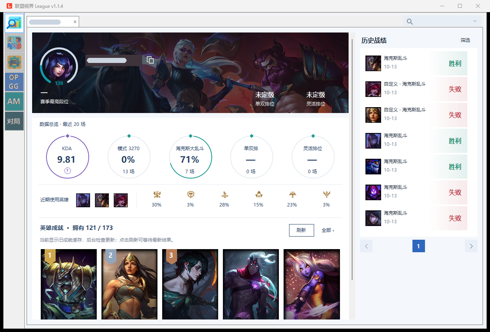
*玩家主页（截图中的玩家名称已遮挡）*

### 2. 对局详情
- 基础数据：双方记分板、装备、符文 / 海克斯、经济与伤害条，突出全场最高项
- 统计：十位玩家的全部指标并排对比
- 图表：按伤害、承伤、经济、视野等分组选择指标绘制对比条形图
- 时间线：人均经济差曲线、击杀地图和事件列表，拖动滑块查看任意时刻

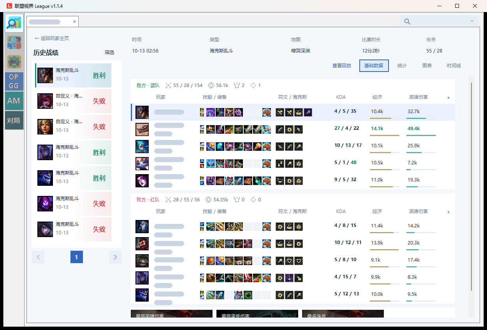
*对局详情 · 基础数据（玩家名称已遮挡）*

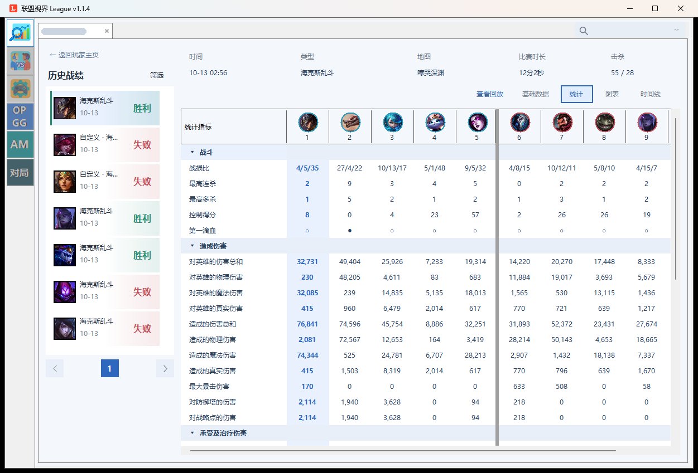
*对局详情 · 统计*

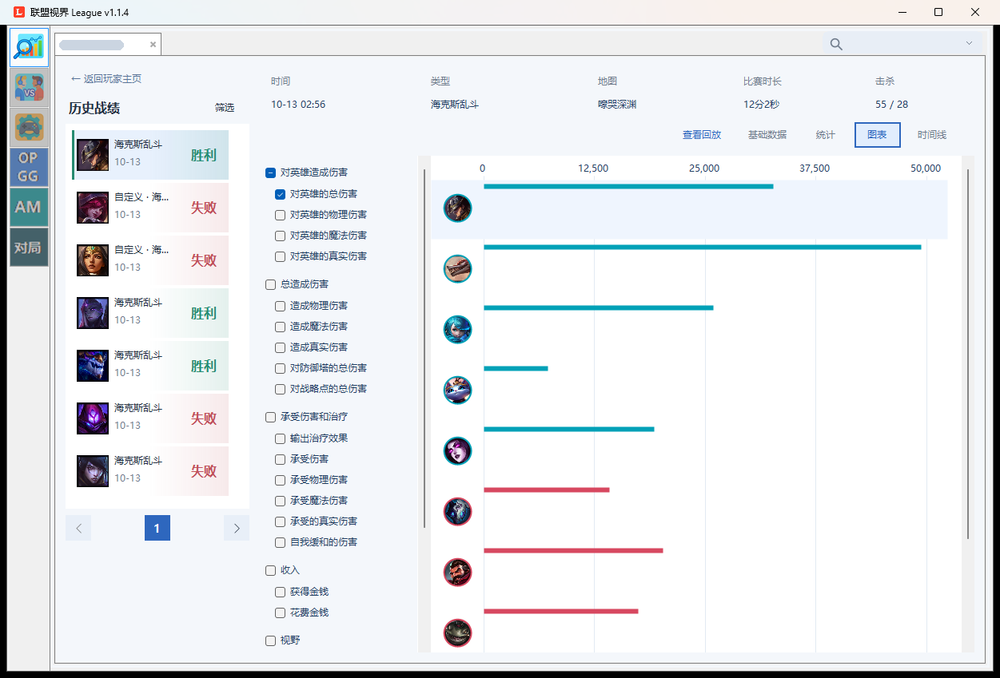
*对局详情 · 图表*

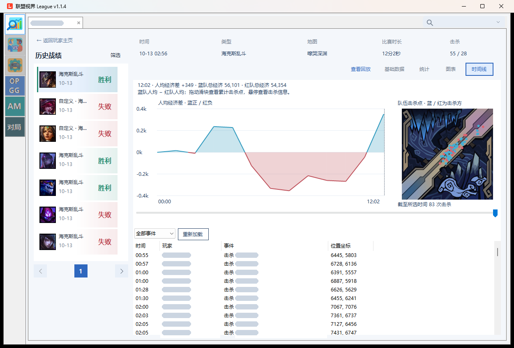
*对局详情 · 时间线（玩家名称已遮挡）*

### 3. 选人与对局房间
- 游戏开始选人阶段自动跳转到战绩界面
- 自动查询我方与敌方近期战绩（每位玩家查询场数可设 10 / 20 / 30 / 50 场），排位、匹配和大乱斗类模式查询对应模式
- 十位玩家卡片显示当前英雄与梯队；组队玩家名称颜色统一，便于辨识
- 单个玩家读取失败时可单独重试，不影响其他卡片

### 4. 选人助手
- 选人时贴靠客户端左侧显示，可从客户端旁的标签展开或收起，也可固定后拖到任意位置
- 按当前模式、地区、段位和分路显示英雄梯队与推荐；大乱斗显示我方与可交换英雄的梯队
- 阵容分析：基于 arammeta 统计模型给出阵容短板和换人后的胜率变化
  - 大乱斗类选人时，主面板状态行下方直接显示结论：海克斯大乱斗为“胜率 · 短板 · 物理占比 · 可换英雄”，普通大乱斗不显示估计胜率
  - 右侧「发送分析」把完整结论发到选人聊天；点结论打开完整阵容分析（能力条、队友搭配、全部换人建议）
- 海克斯大乱斗显示棱彩 / 黄金 / 白银强化推荐、出装与召唤师技能；点击「应用方案」才修改符文
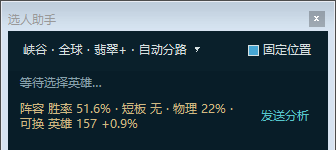
*选人助手主面板的阵容结论与「发送分析」（测试样例，英雄名为占位）*

- 选人助手底部提供「语音输入」：说完后停止录音，使用 SenseVoice 中文模型转换文字，再编辑并确认发送到当前选人聊天；也支持手动输入。默认跟随 Windows 麦克风，也可在设置中指定设备，选人助手与 Game Bar 共用并保存选择。麦克风与中文模型并行准备，设备实际返回录音数据后提示“可以说话了”；模型加载时也可录音，最长 20 秒，保留轻声输入。需要桌面应用麦克风权限；模型未就绪时到「设置 → 消息发送 → 本机语音识别」下载、修复或导入已下载的文件（约 228 MiB）。模型固定版本并校验 SHA-256，之后识别无需联网或 Windows 中文语音组件。录音只保留在内存，结束后清理；不保存录音或草稿、不自动发送。发送前核对选人房间，旧房间草稿不会发送到新房间。

### 5. 攻略数据
- **OP.GG**：英雄榜（胜率、登场率、禁用率、梯队、劣势对局），点击英雄查看召唤师技能、符文、技能加点和出装，可一键应用到工具专用符文页
- **arammeta**：海克斯大乱斗英雄榜，同时展示原始胜率和调整后胜率、样本选取率和样本量；英雄详情含强化、出装对比
- 统计数据带本地缓存，缓存时长可在「设置 → 数据缓存」调整

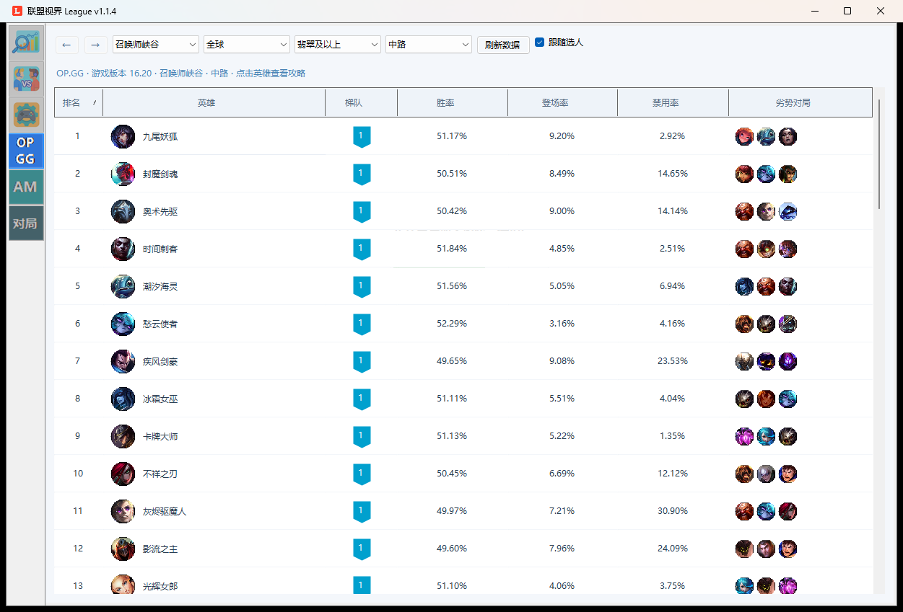
*OP.GG 英雄榜*

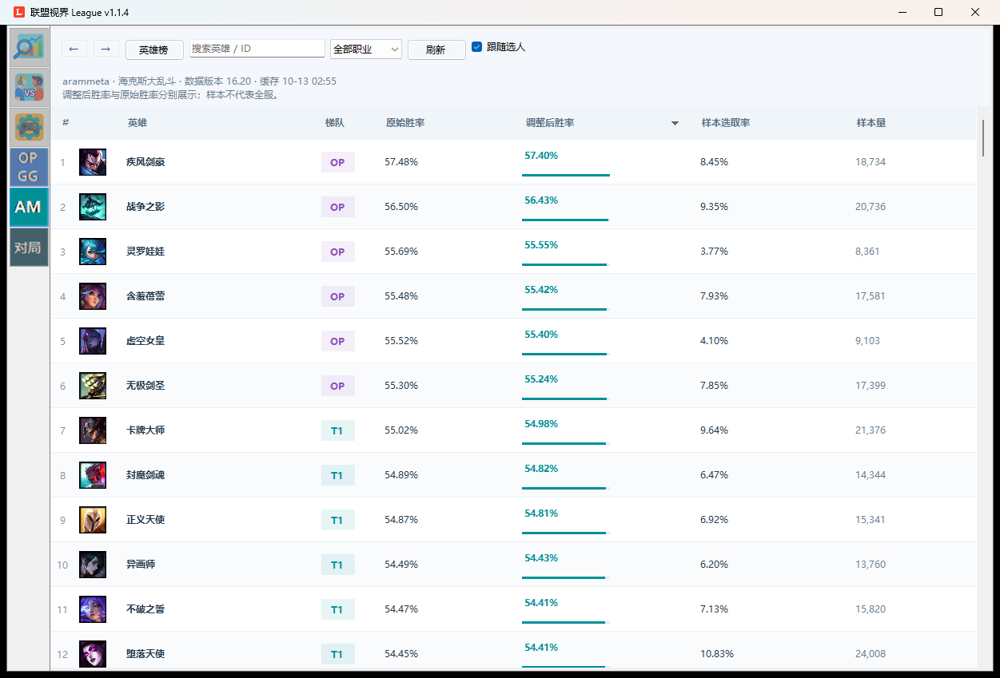
*arammeta 海克斯大乱斗英雄榜*

### 6. 对局速览（桌面窗口 / Xbox Game Bar）
- 进入加载界面后自动展示十位玩家的段位、战绩、梯队和英雄推荐
- 桌面窗口版适用于窗口 / 无边框模式；全屏游戏使用 Game Bar 小组件：按 Win＋G 打开「League 对局速览」，点图钉固定在游戏上方
- Game Bar 名单显示梯队、参团率与装备总价、英雄成就、疑似组队颜色、连死和复活倒计时，以及双方击杀、经济差和团灭提醒
- 英雄详情：技能、出装、海克斯推荐和「本局」面板（经济与团战摘要、个人生存与属性、防御和出装建议、完整符文页）
- 「战绩」页：该玩家近期胜负与连胜连败、平均 KDA、单双 / 灵活段位、行为特征标签（含触发规则与信号数值）和最近对局，只读主窗口已查询的缓存
- 「发送」菜单可把梯队、胜率、熟练度、连死、战绩与特征等信息发到游戏聊天；支持语音输入，识别后编辑确认再发送
- 组件与主程序通过本机文件同步，需保持 League 主程序运行

#### 兵线
底部「兵线 0:19」按钮显示下一波出兵倒计时，点击打开独立的「兵线」页，返回到原来的名单或英雄详情。支持召唤师峡谷（匹配 / 排位 / 快速对局 / 无限火力）、极地大乱斗和海克斯大乱斗；规则整理自游戏数据，详见 [docs/minion-wave-requirements-draft.md](docs/minion-wave-requirements-draft.md)。
- **出波**：下一波倒计时与波次、是否炮车波、之后几波的时间；当前出波间隔与炮车频率，规则变化前提示（如 14:00 起每 25 秒一波）
- **每波价值**：普通波与炮车波的金币和经验，随小兵强化增长
- **各路兵线**：每路一条进度条，标出双方塔与水晶（已摧毁的变灰）和双方最新一波兵的理论位置、预计相遇时间；按建筑损失推测兵线多在哪个半场；下一波到达双方下一座存活防御塔的时间（推塔后自动顺延）
- **超级兵**：水晶被破后每波增加的超级兵数量与预计重生时间
- **现在阵亡需等待**：按各模式复活时间表和双方等级，列出现在阵亡需要等待的秒数
- 「发送 ▾ → 兵线（发到队伍）」可发送出波与炮车、超级兵或阵亡代价；消息在返回游戏、输入前按最新数据生成
- 2999 不提供小兵位置，所有位置和到达时间都是“无人干扰时”的理论推算

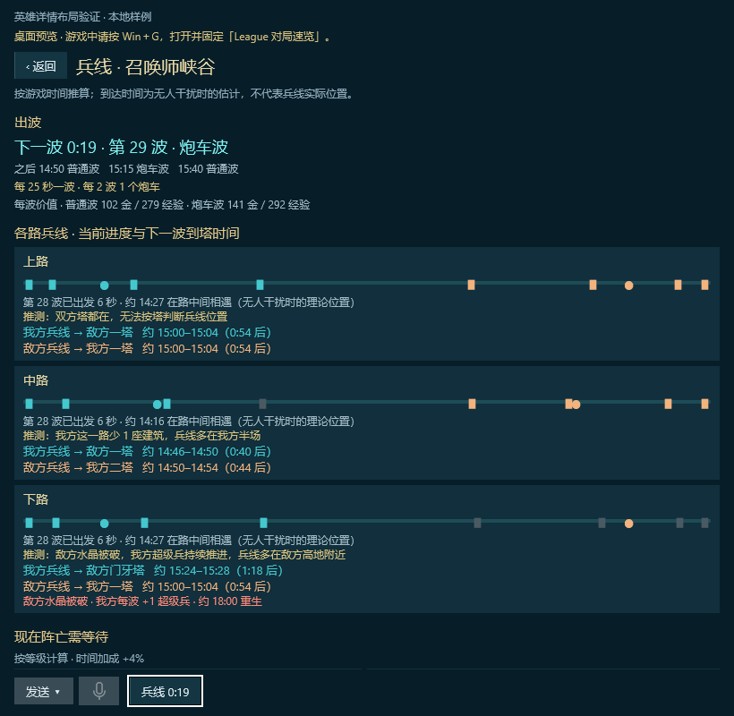
*Game Bar 兵线页（样例数据：召唤师峡谷 14:06，敌方下路水晶已破）*

#### 标记复活
在英雄详情页点「☆ 标记复活」，该英雄的名单卡片变为金色调。被标记英雄阵亡后，底部显示“阵亡 · N 秒后复活”，剩 5 秒变为“即将复活”，复活后提示 10 秒。
- 剩 5 秒和复活时各响一声提示音（单响 / 升调），阵亡本身不响；「提示音：开 / 关」可关闭
- 提示音由 League 主程序播放：组件在游戏获得焦点时是后台应用，Windows 会静音它的声音
- 数据来自游戏的复活倒计时；游戏接口不提供视野，所以无法提示英雄进出视野。不会自动发送聊天

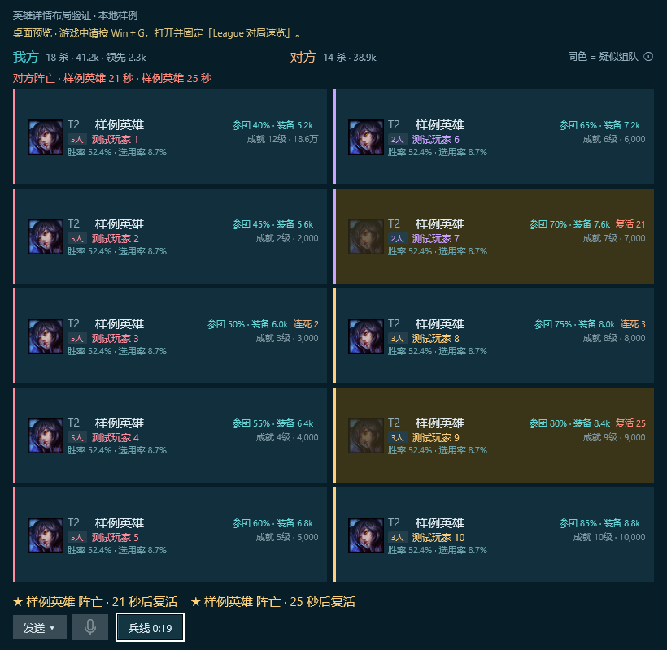
*标记了两名阵亡的敌方英雄：卡片变为金色调，底部显示复活倒计时（样例数据）*

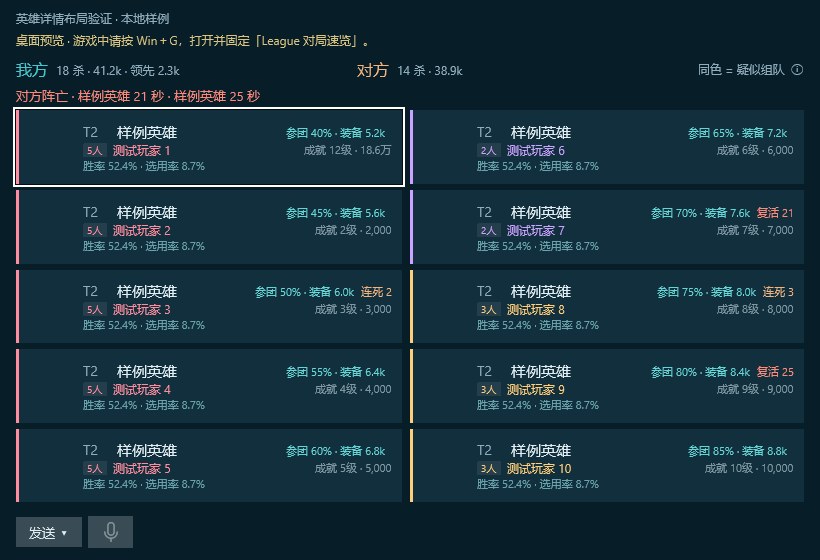
*Game Bar 名单（组件自带的本地样例数据）*

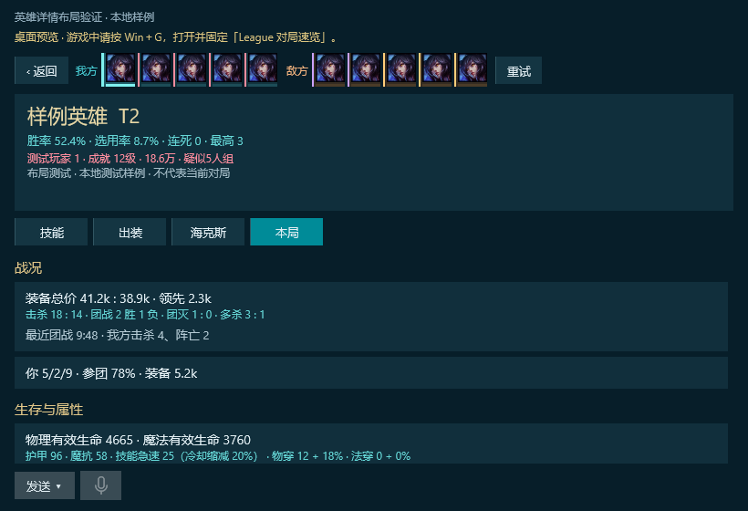
*Game Bar 英雄详情 · 本局（样例数据）*

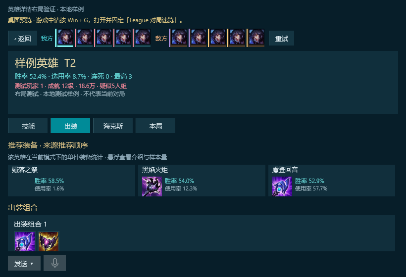
*Game Bar 英雄详情 · 出装（样例数据）*

### 7. 预选英雄配置
- 可添加常用英雄到预选区并自动保存
- 游戏时自动切换排名靠前的英雄
- 支持匹配、排位、大乱斗、海克斯大乱斗，可按模式分别启用

*英雄预选配置界面*

### 8. 消息发送
- 选人界面按 Ctrl＋F7 发送我方战绩；游戏内按 F9 发送我方战绩、F11 发送双方战绩；也可改为发送自定义内容
- 游戏内快捷键需要以管理员身份运行本程序；快捷键使用 Windows 事件接收，没有键盘钩子或按键轮询
- 「设置 → 消息发送 → 快捷发送状态」记录最近一次发送的阶段和失败原因（不记录聊天正文）

*发送战绩示例*

#### 玩家行为特征标签说明

软件会根据玩家最近20场表现自动生成以下**9种行为特征标签**，帮助你快速识别潜在风险玩家：

| 标签         | 触发条件（详细）                                      | 详细含义解释                                                                 | 孤儿指数     |
|--------------|-------------------------------------------------------|-----------------------------------------------------------------------------|--------------|
| **爱投降**   | 投降率 ≥ 40%（最近20场中至少投降8场及以上）           | 该玩家投降意愿极强，逆风时非常容易发起或同意投降，属于典型的“不想打”型选手。 | ★★★★★ 极高   |
| **容易投降** | 投降率 ≥ 28% 但 < 40%（最近20场中投降6场左右）       | 投降意愿明显高于普通玩家，逆风或经济落后时容易选择投降，坚持能力较弱。       | ★★★☆☆ 中     |
| **爱发问号** | 平均每场 Missing Ping（问号）≥ 3.5 次                 | 非常喜欢狂发问号，队友一旦失误或被抓就疯狂标记，压力型选手，容易影响队友心态。 | ★★★★☆ 高     |
| **爱发提醒** | 平均每场 Vision Ping（提醒/视野信号）≥ 3.0 次         | 非常积极使用视野提醒信号，喜欢提示队友注意插眼和视野，属于视野意识较强的玩家。 | ★★☆☆☆ 中     |
| **爱发撤退** | 平均每场 GetBack Ping（撤退信号）≥ 4.0 次             | 极其保守，稍微看到危险就狂发撤退信号，属于“怕死型”或“爱抱怨”玩家。           | ★★★★☆ 高     |
| **爱发危险** | 平均每场 Danger Ping（危险信号）≥ 2.8 次              | 经常标记危险信号，提示队友小心埋伏或即将被抓，预警意识较强。                 | ★★★☆☆ 中     |
| **爱抱怨**   | 撤退信号 ≥ 4.5 且 四种信号总和 ≥ 12                  | **最严重的负面标签**。极度喜欢抱怨，信号使用量极大，属于典型的“玻璃心+喷子”。 | ★★★★★ 极高   |
| **玻璃心**   | 四种信号总和 ≥ 14 或 撤退信号 ≥ 4.2                  | 心态极其脆弱，一点风吹草动就大量使用信号，容易心态崩盘，属于高压力玩家。     | ★★★★★ 极高   |
| **心态容易崩** | 四种信号总和 ≥ 10.5（未达到玻璃心标准）              | 心态稳定性较差，信号使用量明显偏高，逆风时心态容易失衡。                     | ★★★★☆ 高     |

**信号数值显示说明**：
- 发送的消息中会同时显示**具体信号数值**（保留1位小数），例如：`发问号 4.2 | 发撤退 5.3 | 发危险 2.1`
- 只有该信号平均值 > 0 时才会显示，使用 :F1 格式，保留一位小数（如 3.0、4.5）帮助你更直观判断严重程度。
- 无论是否有特征标签，只要有对应信号数据就会显示数值，帮助你更直观判断玩家行为严重程度。

**示例输出**：
- `张三 近20场 胜率 [42%] | 发问号 5.2 | 发撤退 4.8 特征 [玻璃心、爱发问号]`

### 9. 设置与自动化
- 对局自动化：自动接受对局（可延迟 5 / 10 秒）、自动跳过点赞界面和结算统计界面
- 客户端维护：大厅或选人界面卡顿时重启客户端界面（无需重新登录），退出游戏后清理残留客户端进程
- 到点关机 · 防熬夜：每天到点自动关机；正在对局时等本局结束再关，关机前倒计时可在托盘取消本次；关闭联盟视界后计划仍然有效
- 英雄联盟安装目录可自动识别或手动选择（官方 / WeGame）

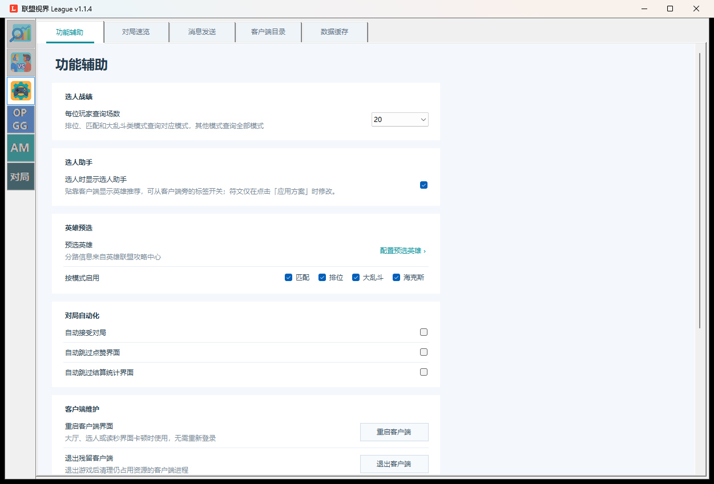
*设置 · 功能辅助*

---

## 下载与安装

上游版本：[mizi6654/LeagueHistory Releases](https://github.com/mizi6654/LeagueHistory/releases/latest)

本分支发布包：`League-<版本>-win-x64.zip`，由 `Scripts/Publish-Release.ps1 -Version <版本>` 生成（1.1.4 约 77.7 MB）。

> 压缩包内文件直接位于根目录，与上游发布包相同；解压到一个文件夹后运行 `League.exe` 即可，发布包自带 .NET 运行时，无需另外安装。游戏内快捷键和 Game Bar 发送需要以管理员身份运行。
>
> **Game Bar 组件**：在「设置 → 对局速览」选择 Game Bar 后点「安装组件」。发布包附带的组件安装包不签名，安装时在本机生成专用证书（私钥不可导出）并签名；首次安装需要一次管理员授权，把证书加入本机“受信任的人”。不需要开启开发者模式。
>
> **自动更新**：启动时仍检查上游仓库（mizi6654/LeagueHistory）的最新发布，版本号高于本机时询问是否更新；选择更新会替换为上游版本，不含本分支的改动。
>
> **语音模型**：中文模型（约 228 MiB）不随压缩包附带，首次使用前在「设置 → 消息发送 → 本机语音识别」下载；下载失败时可复制镜像 / 官方直链手动下载，再用「导入已下载的文件」导入。

## 开发与验证

- 编译：`dotnet build League.csproj -c Release`；Game Bar 组件见 [GameBar/README.md](GameBar/README.md)
- 回归测试：编译 `Tests/StatisticsChecks/StatisticsChecks.csproj` 后直接运行，或用 `--settings-checks`、`--room-player-checks` 等参数运行单项；聊天发送、麦克风和关机计划均使用模拟器，不会产生真实操作
- 代码规范：新增源码运行 `Scripts/Check-CodeQuality.ps1`；修改上游原有文件后运行 `Scripts/Check-UpstreamChanges.ps1`，详见 [AGENTS.md](AGENTS.md) 和 [docs/code-quality.md](docs/code-quality.md)
- 设计文档：[docs](docs) 目录收录统计与时间线、历史筛选、到点关机、OP.GG / arammeta 需求与阵容分析等说明

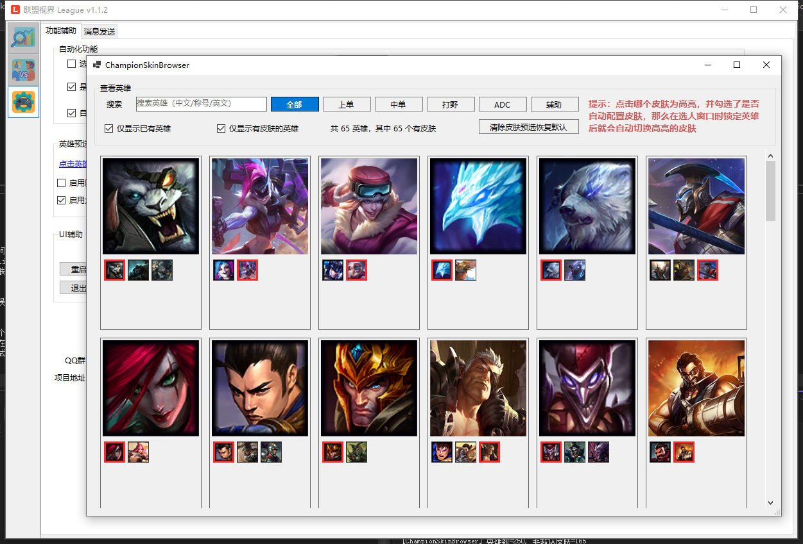
*皮肤配置界面*

---

## 历史版本更新记录
### v1.1.x（geezhu 分支）
- 见上方「相对上游的主要改动」
- v1.1.4：设置页按使用顺序重排，到点关机补充用途说明；Game Bar 组件改为安装时本机签名
- 1.1.4 之后（尚未发布）：Game Bar 兵线页（出波、炮车、兵线进度、到塔时间、超级兵、阵亡代价及队伍聊天发送）、标记英雄复活提醒与提示音；选人助手主面板显示阵容结论并可一键发送

### v1.0.9
- 新增配置跳过点赞界面
- 新增配置路过结算界面
- 新增配置发送战绩时过滤自己开关
- 新增配置发送战绩时可以为英雄名称（能解决名称屏蔽问题）

### v1.0.8
- 新增自动接受对局配置
- 新增选人窗口战绩消息发送（可自定义消息）
- 新增游戏内战绩消息发送（可自定义消息）

### v1.0.7
- 修复战绩查询失败问题
- 修复战绩卡片丢失问题

### v1.0.6
- 修复战绩卡片丢失问题
- 新增匹配、排位、大乱斗、海克斯大乱斗自选英雄开关
- 新增自动更新功能

### v1.0.5
- 新增配置：卡片显示支持过滤模式及查询所有战绩
- 新增配置：添加匹配、排位、大乱斗英雄预选功能

---

## 联系与反馈
- 上游 GitHub Issues: [https://github.com/mizi6654/LeagueHistory/issues](https://github.com/mizi6654/LeagueHistory/issues)
- 本分支: [https://github.com/geezhu/LeagueHistory](https://github.com/geezhu/LeagueHistory)
- QQ群联系: `1035850775`
- 欢迎大家提交问题与建议，帮助“联盟视界”持续优化体验！
